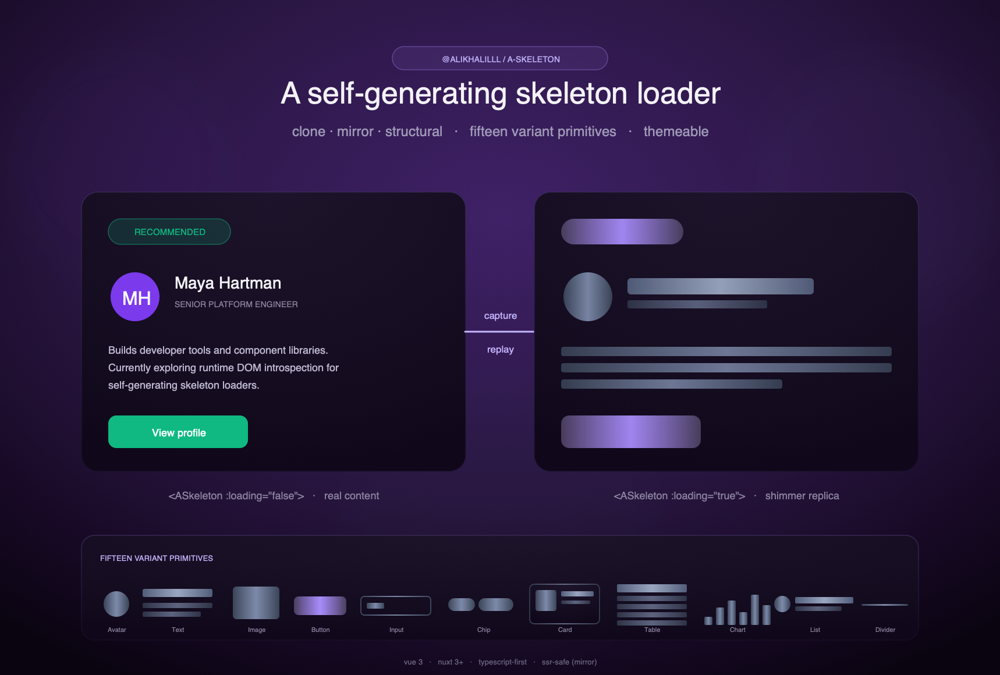

# `@alikhalilll/a-skeleton`

> Smart skeleton states for Vue 3 / Nuxt 3+.
> Measure your content, draw bones over it, cross-fade when data lands.
> Nothing moves when it arrives.

<p align="center">
  
</p>

[](https://www.npmjs.com/package/@alikhalilll/a-skeleton)
[](./LICENSE)
[](https://www.npmjs.com/package/@alikhalilll/a-skeleton)

---

## Install

### Nuxt 3 / 4

```bash
pnpm add @alikhalilll/a-skeleton
```

```ts
// nuxt.config.ts
export default defineNuxtConfig({
  modules: ['@alikhalilll/a-skeleton/nuxt'],
  css: ['@alikhalilll/a-skeleton/styles.css'],
});
```

Every component (`<ASkeleton>`, `<ASkeletonText>`, `<ASkeletonCard>`, …) is
auto-imported.

### Vue + Vite

```bash
pnpm add @alikhalilll/a-skeleton
```

```ts
// main.ts
import '@alikhalilll/a-skeleton/styles.css';
```

Optional auto-resolve via `unplugin-vue-components`:

```ts
// vite.config.ts
import Components from 'unplugin-vue-components/vite';
import ASkeletonResolver from '@alikhalilll/a-skeleton/resolver';

export default { plugins: [Components({ resolvers: [ASkeletonResolver()] })] };
```

---

## 30-second tour

```vue
<script setup lang="ts">
import { ref } from 'vue';

interface User {
  name: string;
  role: string;
  bio: string;
  avatar: string;
}

const SAMPLE: User = {
  name: 'Sample Person',
  role: 'Loading…',
  bio: 'A couple of lines of text that'll be replaced with the real bio once the fetch lands.',
  avatar: 'https://i.pravatar.cc/96?u=sample',
};

const user = ref<User | null>(null);
fetch('/api/me').then((r) => r.json()).then((u) => (user.value = u));
</script>

<template>
  <ASkeleton :data="user" :sample="SAMPLE">
    <template #default="{ data }">
      <article class="flex items-start gap-4 p-4">
        
        <div>
          <h3 class="text-base font-semibold">{{ data.name }}</h3>
          <p class="text-sm text-gray-500">{{ data.role }}</p>
          <p class="mt-2 text-sm">{{ data.bio }}</p>
        </div>
      </article>
    </template>
  </ASkeleton>
</template>
```

What happens:

1. On first paint, `data` is `null`. `<ASkeleton>` draws a skeleton shaped
   like the `SAMPLE` value.
2. The fetch lands. `data` resolves to the real user.
3. The reveal planner decides whether to crossfade, cascade top-to-bottom,
   or just flip (`smart` mode, default). No layout shift — the skeleton
   was already the exact shape of the loaded content.

---

## Eight real-world examples

Each example is live in the Nuxt playground at `/showcases` and ships as
a `.vue` component under
[`playgrounds/nuxt/components/showcases/`](../../../playgrounds/nuxt/components/showcases/).
They mirror [skullet.lochie.me](https://skullet.lochie.me/)'s showcase
gallery one-to-one.

### 1. Article card

Avatar + title + "N min read".

```vue
<ASkeleton :data="article" :sample="SAMPLE_ARTICLE">
  <template #default="{ data }">
    <article class="flex items-start gap-3">
      
      <div>
        <h3 class="text-lg font-semibold">{{ data.title }}</h3>
        <p class="mt-1 text-sm text-gray-500">
          {{ data.author }} · {{ data.readMins }} min read
        </p>
      </div>
    </article>
  </template>
</ASkeleton>
```

### 2. Image gallery grid

Six image placeholders in a 3 × 2 grid. The `:repeat="6"` + `#prototype`
pair lets the skeleton render six copies before the real array arrives.

```vue
<ASkeleton :data="shots" :sample="SAMPLE_SHOTS" :repeat="6" class="grid grid-cols-3 gap-3">
  <template #prototype>
    <figure class="aspect-[16/10] rounded-lg bg-gray-100" />
  </template>
  <template #default="{ data }">
    <figure
      v-for="shot in data"
      :key="shot.id"
      class="aspect-[16/10] overflow-hidden rounded-lg"
    >
      
    </figure>
  </template>
</ASkeleton>
```

### 3. Comment thread

Avatar + username + 3 wrapped comments + "Send" button. The measure engine
reads each comment's wrapped line rects via the `Range` API — bars match
wrap positions exactly.

```vue
<ASkeleton :data="thread" :sample="SAMPLE_THREAD">
  <template #default="{ data }">
    <section class="flex flex-col gap-4">
      <header class="flex items-center gap-3">
        
        <div>
          <p class="font-semibold">{{ data.author }}</p>
          <p class="text-xs text-gray-500">just now</p>
        </div>
      </header>
      <ul class="flex flex-col gap-3">
        <li v-for="c in data.comments" :key="c.id" class="flex gap-3 rounded-lg bg-gray-50 p-3">
          
          <p>{{ c.body }}</p>
        </li>
      </ul>
      <button class="self-end rounded-md bg-indigo-600 px-4 py-2 text-white">
        Send
      </button>
    </section>
  </template>
</ASkeleton>
```

### 4. Dashboard metrics

Four stat cards in a 2 × 2 grid. The `smart` planner picks
`sequence` (byRow) because the content has >3 pieces — cards arrive
top-to-bottom.

```vue
<ASkeleton :data="metrics" :sample="SAMPLE_METRICS" class="grid grid-cols-2 gap-3">
  <template #default="{ data }">
    <article v-for="m in data" :key="m.id" class="rounded-lg bg-gray-50 p-4">
      <p class="text-xs uppercase tracking-wide text-gray-500">{{ m.label }}</p>
      <p class="mt-2 text-2xl font-bold">{{ m.value }}</p>
      <p class="mt-2 text-xs font-semibold" :class="m.up ? 'text-green-500' : 'text-red-500'">
        {{ m.delta }}
      </p>
    </article>
  </template>
</ASkeleton>
```

### 5. Settings panel

Vertical list of 3 toggle rows. `reveal="instant"` opts out of the fade
— useful when the list is small and the loading state is brief.

```vue
<ASkeleton :data="settings" :sample="SAMPLE_SETTINGS" reveal="instant">
  <template #default="{ data }">
    <div v-for="s in data" :key="s.id" class="flex items-center justify-between gap-4 rounded-lg bg-gray-50 p-3">
      <div>
        <p class="font-semibold">{{ s.label }}</p>
        <p class="text-xs text-gray-500">{{ s.description }}</p>
      </div>
      <button :aria-pressed="s.enabled" class="h-6 w-11 rounded-full bg-indigo-600" />
    </div>
  </template>
</ASkeleton>
```

### 6. Activity feed

Three notification rows (avatar + user + action + timestamp).

```vue
<ASkeleton :data="activity" :sample="SAMPLE_ACTIVITY" reveal="sequence">
  <template #default="{ data }">
    <article
      v-for="entry in data"
      :key="entry.id"
      class="flex items-start gap-3 rounded-lg bg-gray-50 p-3"
    >
      
      <div>
        <p><strong>{{ entry.actor }}</strong> {{ entry.action }}</p>
        <p class="text-xs text-gray-500">{{ entry.when }}</p>
      </div>
    </article>
  </template>
</ASkeleton>
```

### 7. Track player

Album art + play controls + time display. The measure engine's clip-aware
rounded-corner handling keeps the album art corners inside the player's
rounded outer rect.

```vue
<ASkeleton :data="track" :sample="SAMPLE_TRACK">
  <template #default="{ data }">
    <article class="flex items-center gap-4 rounded-xl bg-gray-50 p-4">
      
      <div class="flex-1">
        <h3 class="font-semibold">{{ data.title }}</h3>
        <p class="text-sm text-gray-500">{{ data.artist }}</p>
        <div class="mt-3 flex items-center gap-3">
          <span class="text-xs tabular-nums">{{ data.time }}</span>
          <div class="relative h-1 flex-1 rounded-full bg-gray-200">
            <span class="absolute inset-y-0 left-0 w-1/3 rounded-full bg-indigo-600" />
          </div>
          <span class="text-xs tabular-nums">{{ data.total }}</span>
        </div>
      </div>
      <button class="flex size-10 items-center justify-center rounded-full bg-indigo-600 text-white">▶</button>
    </article>
  </template>
</ASkeleton>
```

### 8. Portfolio

Header with total + 3 asset rows. `tabular-nums` aligns the numbers perfectly
between skeleton and loaded content.

```vue
<ASkeleton :data="portfolio" :sample="SAMPLE_PORTFOLIO">
  <template #default="{ data }">
    <section class="flex flex-col gap-3">
      <header class="flex items-end justify-between">
        <div>
          <p class="text-xs uppercase tracking-wide text-gray-500">Total</p>
          <p class="text-2xl font-bold tabular-nums">{{ data.total }}</p>
        </div>
        <p class="font-semibold tabular-nums" :class="data.up ? 'text-green-500' : 'text-red-500'">
          {{ data.delta }}
        </p>
      </header>
      <ul>
        <li v-for="a in data.assets" :key="a.id" class="flex items-center justify-between rounded-lg bg-gray-50 p-3">
          <div class="flex items-center gap-3">
            <span class="flex size-9 items-center justify-center rounded-full bg-gray-200 font-bold">
              {{ a.ticker }}
            </span>
            <div>
              <p class="font-semibold">{{ a.name }}</p>
              <p class="text-xs text-gray-500">{{ a.ticker }}</p>
            </div>
          </div>
          <div class="text-right tabular-nums">
            <p class="font-semibold">{{ a.value }}</p>
            <p class="text-xs font-semibold" :class="a.up ? 'text-green-500' : 'text-red-500'">
              {{ a.delta }}
            </p>
          </div>
        </li>
      </ul>
    </section>
  </template>
</ASkeleton>
```

---

## API — props

| Prop              | Type                                               | Default     | Description                                                                                                                                                 |
| ----------------- | -------------------------------------------------- | ----------- | ----------------------------------------------------------------------------------------------------------------------------------------------------------- |
| `data`            | `T \| null`                                        | —           | Data-driven mode: `null`/`undefined` → skeleton; otherwise → content. Binding this (even to `null`) opts into the `#default="{ data }"` slot scope.         |
| `sample`          | `T`                                                | —           | Stand-in value used to shape the skeleton before any data arrives.                                                                                          |
| `loading`         | `boolean`                                          | —           | Force the skeleton pane regardless of data. Pair with `data` to show the skeleton over existing content (a refetch).                                        |
| `error`           | `unknown`                                          | —           | When non-null, render the `#error` slot instead. `@reveal` does **not** fire on error-to-content transitions.                                               |
| `empty`           | `boolean`                                          | `false`     | Render the `#empty` slot (falls back to `#default` if no `#empty` provided).                                                                                |
| `mode`            | `'measure' \| 'clone' \| 'mirror'`                 | `'measure'` | Rendering strategy — see **Modes** below.                                                                                                                   |
| `reveal`          | `'smart' \| 'together' \| 'sequence' \| 'instant'` | `'smart'`   | How content transitions in over the skeleton — see **Reveal animations**.                                                                                   |
| `cacheKey` / `id` | `string`                                           | auto        | Stable key for shape memory across visits + size-mismatch warnings.                                                                                         |
| `label`           | `string`                                           | —           | Screen-reader text announced while loading (`"Loading profile"`).                                                                                           |
| `debug`           | `boolean`                                          | `false`     | Force-enable the debug overlay for this instance. Overlay also activates globally via `?a-skel-debug=1`.                                                    |
| `repeat`          | `number`                                           | `1`         | Number of prototype copies to render during loading. Pair with a `grid`/`flex` class and a `#prototype` to fill the layout 1 : 1 with the eventual content. |
| `animation`       | `'shimmer' \| 'pulse' \| 'none'`                   | `'shimmer'` | Bone animation. `prefers-reduced-motion` disables animation automatically.                                                                                  |
| `persist`         | `boolean`                                          | `false`     | Mirror captured shapes to `localStorage` so first-visit skeletons survive reloads.                                                                          |
| `maxDepth`        | `number`                                           | `16`        | Max recursion depth during shape capture.                                                                                                                   |
| `maxNodes`        | `number`                                           | `600`       | Hard cap on captured nodes. Walks past this bail with `truncated: true` and a one-time `console.warn`.                                                      |
| `minNodeSize`     | `number`                                           | `4`         | Minimum CSS-pixel size (either axis) for an element to count.                                                                                               |
| `class`           | `HTMLAttributes['class']`                          | —           | Class on the wrapper. Persists across loading↔loaded so layout classes keep working in both states.                                                         |

Emits:

- `@reveal` — fires exactly once per `skeleton → content` edge. Not fired
  on error-to-content, empty-to-content, or pane churn between non-skeleton
  states.

Slots:

- `#default` — the real content. In data-driven mode: `#default="{ data }"`.
- `#error="{ error }"` — the error pane.
- `#empty` — the empty pane. Falls back to `#default` with no data.
- `#prototype` — single-instance template used as the shape source during
  loading when the default slot iterates with `v-for`.
- `#skeleton` — a custom skeleton that overrides every rendering mode.
  Wrapped with `[data-a-skel-own]` so the engine doesn't descend.
- `#fallback` — custom cache-miss UI (mirror mode).

---

## Modes

| Mode                      | How it works                                                                                                                                                                                                                                                                                                                                          | Best when                                                                                                                      |
| ------------------------- | ----------------------------------------------------------------------------------------------------------------------------------------------------------------------------------------------------------------------------------------------------------------------------------------------------------------------------------------------------- | ------------------------------------------------------------------------------------------------------------------------------ |
| **`measure`** _(default)_ | **Ghost + layer + bones** (skullet-style). The slot mounts invisibly inside `[data-a-skel-ghost]`; the measurement engine walks it once, reads Canvas font metrics for text bars, applies clip-aware rounded corners, and paints `<div data-a-skel-rect>` bones into a shadow-DOM layer. `MutationObserver` + `ResizeObserver` re-measure on changes. | New code; the clearest, most faithful bones. Reflows with layout.                                                              |
| **`clone`**               | Mounts the slot off-screen inside a capture host, snapshots every leaf's `getComputedStyle()`, then replays the snapshot as positioned divs each carrying its captured inline CSS.                                                                                                                                                                    | You want the skeleton to look _pixel-identical_ to the real surface (bg, border, shadow, filter, transform). Client-side only. |
| **`mirror`**              | Walks the slot's **vnode tree** at render time. Preserves every element with its real `class` / inline `style`; swaps text leaves for `<span class="a-skel-text-content">`.                                                                                                                                                                           | SSR-safe placeholders (no DOM read needed). First-paint fallback before measure/clone's observers settle.                      |

Plus an advanced opt-in: `useSkeleton()` + `<ASkeletonLayer>` for **structural
normal-flow** skeletons that reflow with their parent. See the "Composables"
section.

---

## Reveal animations

| Value                 | Behaviour                                                                                                                                                                                             |
| --------------------- | ----------------------------------------------------------------------------------------------------------------------------------------------------------------------------------------------------- |
| `'smart'` _(default)_ | Context-aware. Instant for sub-150 ms waits or mid-gesture (so a fast load never flashes). Quick 120 ms crossfade on refetch. 200 ms crossfade for small reveals. `byRow` cascade for larger reveals. |
| `'together'`          | One crossfade for the whole pane (200 ms).                                                                                                                                                            |
| `'sequence'`          | Top-to-bottom cascade (320 ms span). Secondary text (smaller font) lags behind primary.                                                                                                               |
| `'instant'`           | No animation. Snap. Use when the pane is already small / fast.                                                                                                                                        |

`prefers-reduced-motion: reduce` short-circuits every mode to instant.

---

## Hints — opt out of the walker

Mark elements during the walk via data attributes OR equivalent class names
(both work; both resolve through the same predicate module):

| Attribute              | Class                | Effect                                                                                               |
| ---------------------- | -------------------- | ---------------------------------------------------------------------------------------------------- |
| `data-skeleton-ignore` | `.a-skel-ignore`     | Skip the element entirely. Use for decorative chrome (background SVGs, dividers, persistent badges). |
| `data-skeleton-stop`   | `.a-skel-stop`       | Stop recursing. Render as a single block carrying the outer class/style.                             |
| `data-skeleton-block`  | `.a-skel-block-hint` | Force atomic shimmer-block treatment, regardless of tag.                                             |
| `data-skeleton-own`    | `.a-skel-own`        | This subtree draws its own skeleton. The walker treats it as atomic + leaves the inner markup alone. |

---

## Dev + debug

In development:

- `warnMissingSample(key, data)` — logs a `:sample={…}` suggestion the
  first time a data-driven consumer flips `null → T` without a `:sample`
  bound. The suggestion is a `sampleFrom(data)`-scrambled literal you can
  paste into the template.
- `warnSizeMismatch(key, skelBox, contentBox)` — logs when the loaded
  content's rect differs from the skeleton's final rect by >10%.
- `warnUnsizedImage(src)` — logs when an `` inside the content has
  no intrinsic `width` / `height` / `aspect-ratio` and jumps after decode.

Debug overlay — toggle any of:

- URL param: `?a-skel-debug=1`
- `localStorage['a-skel:debug'] = '1'`
- `<ASkeleton debug />` on a specific instance (descendants inherit via
  `[data-a-skel-debug]` ancestor lookup)
- `setDebug(true)` programmatically

The overlay draws a dashed outline per `<ASkeleton>` — blue while loading
(with a source tag: `data` / `sample` / `cache` / `prototype` / `default` /
`fallback`), green when content lands without jumping, red when the delta is
non-zero. An **x-ray** checkbox reveals the ghost through the bones in
magenta so you can see what was measured.

---

## Theming

Set CSS variables on `:root`, a wrapper class (multi-tenant), or inline:

| Token                   | Used for                                                        |
| ----------------------- | --------------------------------------------------------------- |
| `--ak-skel-base`        | Bone fill.                                                      |
| `--ak-skel-highlight`   | Shimmer sweep colour.                                           |
| `--ak-skel-radius`      | Default bone border-radius.                                     |
| `--ak-skel-radius-sm`   | Tighter radius (text bars, chips).                              |
| `--ak-skel-radius-lg`   | Wider radius (cards, images).                                   |
| `--ak-skel-duration`    | Animation cycle length.                                         |
| `--ak-skel-pulse-min`   | Opacity at the trough of the pulse cycle.                       |
| `--ak-skel-ring`        | Subtle inset-ring colour.                                       |
| `--ak-skel-icon`        | Placeholder icon colour.                                        |
| `--ak-skel-text-top`    | `ascender` / `cap-height` / `x-height` — top edge of text bars. |
| `--ak-skel-text-bottom` | `baseline` / `descender` — bottom edge of text bars.            |

Light / dark are driven by the same tokens — ships with sensible defaults
plus a `.dark` scope override. The package also honours
`@media (prefers-color-scheme: dark)` when no explicit `.dark` / `.light`
class is on an ancestor.

```vue
<ASkeleton :loading style="--ak-skel-base: hotpink; --ak-skel-radius: 9999px;">
  <UserCard />
</ASkeleton>
```

---

## Variant primitives

When auto-capture isn't the right fit — loading states without real
content to wrap, very dense layouts, screens you'd rather author once —
drop in a named variant. Each ships `role="status"`, `aria-busy="true"`,
and a visually-hidden `Loading…` label.

| Component             | Shape                                 | Key props                                              |
| --------------------- | ------------------------------------- | ------------------------------------------------------ |
| `<ASkeletonText>`     | n stacked bars; last 65 % width       | `lines`, `width`                                       |
| `<ASkeletonHeading>`  | one bar sized to the heading level    | `level` (1–6), `width`                                 |
| `<ASkeletonAvatar>`   | circle / square / rounded             | `size`, `shape`                                        |
| `<ASkeletonImage>`    | aspect-ratio rect with icon           | `ratio`, `width`, `height`, `showIcon`                 |
| `<ASkeletonVideo>`    | rect with play-icon                   | `ratio`, `width`, `height`, `showIcon`                 |
| `<ASkeletonButton>`   | rounded rect, filled / outlined       | `width`, `height`, `outlined`                          |
| `<ASkeletonInput>`    | bordered rect with caret bar          | `width`, `height`                                      |
| `<ASkeletonChip>`     | small pill                            | `width`, `height`                                      |
| `<ASkeletonListItem>` | avatar + n text lines + trailing      | `avatar`, `lines`, `trailing`                          |
| `<ASkeletonCard>`     | media + heading + paragraph + actions | `media`, `heading`, `lines`, `actions`, `footerAvatar` |
| `<ASkeletonTable>`    | header row + n × m body cells         | `rows`, `columns`, `showHeader`                        |
| `<ASkeletonChart>`    | n vertical bars of varying heights    | `bars`, `height`, `showHeader`                         |
| `<ASkeletonForm>`     | label + input pairs + submit          | `fields`, `showSubmit`                                 |
| `<ASkeletonArticle>`  | heading + media + n paragraphs        | `media`, `paragraphs`, `linesPerParagraph`             |
| `<ASkeletonDivider>`  | thin shimmer rule                     | `thickness`                                            |

Every variant accepts `animation="pulse | shimmer | wave | none"`, `class`,
`style`.

---

## Composables + utilities (advanced)

```ts
import {
  // Core engine
  measureSkeleton, // (root, layer, opts) → SkeletonRect[]
  drawSkeleton, // paint rects into a shadow-DOM layer
  metricsOf, // Canvas font metrics
  barOf, // ascender→descender bar math
  clipWithin, // rounded-corner intersection

  // Reveal planner
  planReveal, // (mode, ctx) → Plan
  fadeIn,
  fadeOut, // the applier
  pieces,
  unitOf, // content inspection helpers

  // Lifecycle
  resolveState, // pure state resolver (loading | error | empty | content)
  useSkeletonState, // state composable
  useSkeletonSource, // shape precedence waterfall
  useSkeletonLifecycle, // reveal animation + @reveal + warnings

  // Legacy / advanced
  useSkeleton,
  useShapeProbe,
  captureSnapshot,
  walkDom,
  walkStructural,
  buildStructuralSkeleton,
  fingerprintSlot,

  // Shape persistence
  rememberShape,
  recallShape,
  forgetShapes,
  trackShape,
  flushShapes,

  // Debug + warnings
  debugging,
  reportLoading,
  reportReveal,
  setDebug,
  warnMissingSample,
  warnSizeMismatch,
  warnUnsizedImage,

  // Hints
  isIgnored,
  isStopped,
  isForcedBlock,
  isSelfSkeletonising,
  HINT_ATTRS,
  HINT_CLASSES,
} from '@alikhalilll/a-skeleton';
```

---

## Accessibility

- `<ASkeleton>` carries `role="status"` + `aria-busy="true"` + `aria-live="polite"`
  while loading.
- A visually-hidden status span (`[data-a-skel-status]`) carries the
  `label` prop so screen readers announce "Loading profile" instead of
  silence.
- Every emitted bone carries `aria-hidden="true"`.
- Mirror mode disables `user-select` and `pointer-events` on the slot
  tree during loading.
- `prefers-reduced-motion` strips every animation.

---

## SSR

- **`mode="mirror"`** is fully SSR-safe — the walker runs on vnodes, no
  `window` access required.
- **`mode="measure"`** and **`mode="clone"`** need the DOM. The wrapper
  renders normal markup on the server; the measurement + bones kick in
  on hydration.

---

## Browser support

Evergreen — last two versions of Chrome, Edge, Firefox, Safari and the
matching mobile WebViews. Uses `Range.getClientRects()`,
`ResizeObserver`, `MutationObserver`, shadow DOM, CSS `contain: paint` —
all universal since 2022. No polyfills required.

---

## License

[MIT](./LICENSE) © alikhalilll
